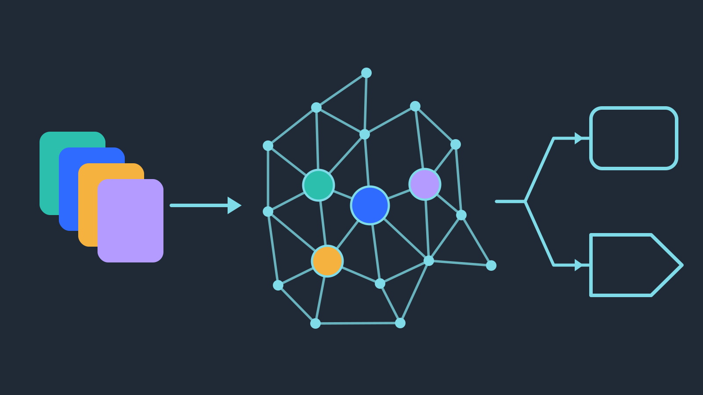

<p align="center">
  
</p>

# MaSyMoS 2.0

MaSyMoS (Management System for Models and Simulations) stores, links and retrieves systems
biology models and their metadata. It reads SBML, CellML, SED-ML and OWL/COMBINE documents,
keeps them in Neo4j as one graph, joins them across formats, and exposes the result through a
REST service and a command line interface.

<p align="center">   </p>

This repository is the modernised MaSyMoS 2.0. The four modules build as one Maven reactor. The
1.x code base, which this replaces, remains readable in the archived MaSyMoS repositories.

## How it works

A document is read by the parser for its format, written to Neo4j as one graph that is shared by
every format, and queried back through the REST service or the CLI. Cross-format identity (a model
referenced by a SED-ML document, an annotation shared by an ontology term) is a graph edge, not a
lookup table.

<p align="center">
  
</p>

## Modules

| Module | What it is |
| --- | --- |
| `masymos-core` | Domain model, extractor contracts, query contracts, result types |
| `masymos-neo4j` | Neo4j Java Driver implementation of the storage and query contracts |
| `masymos-service` | Spring Boot REST service; replaces the 1.x Neo4j server plugin |
| `masymos-cli` | picocli command line interface, backed by the REST service |

## Requirements

- JDK 25 - the reactor compiles with `--release 25`
- Maven 3.9 or newer
- Neo4j 2026.05 for a running service, or Docker with Compose for the packaged setup

## Build and test

```powershell
cd modern
mvn -q verify
```

`verify` compiles all modules and runs the unit test suite. A handful of fixture tests read the
workspace's model corpus (SBML, CellML, SED-ML, OWL) and report themselves as skipped here, each
with its reason. Two integration lanes are opt-in and need a database; see
[`docs/building.md`](docs/building.md).

## Run the service

The packaged setup starts Neo4j and the service together:

```powershell
cd modern
'MASYMOS_NEO4J_PASSWORD=<password>' | Out-File -Encoding ascii .env
docker compose --env-file .env up -d --build
```

Without Docker, after `mvn -q verify`:

```powershell
cd modern
java -jar masymos-service/target/masymos-service-2.0.0-SNAPSHOT.jar
```

The service listens on `http://localhost:8080`.

## Use the command line interface

The CLI talks to a running service (default `http://localhost:8080`, change it with `--api-url`).
Because the module depends on `masymos-core` and `masymos-neo4j` at the same version, install the
reactor into your local Maven repository once, then run the CLI:

```powershell
cd modern
mvn -q -DskipTests install
mvn -q -pl masymos-cli exec:java '-Dexec.mainClass=org.masymos.cli.MaSyMoSMain' '-Dexec.args=--help'
mvn -q -pl masymos-cli exec:java '-Dexec.mainClass=org.masymos.cli.MaSyMoSMain' `
  '-Dexec.args=index sbml --source file:///path/to/model.sbml'
mvn -q -pl masymos-cli exec:java '-Dexec.mainClass=org.masymos.cli.MaSyMoSMain' `
  '-Dexec.args=query models --keyword glucose --top 10'
```

Quoting the `-D` arguments is deliberate: PowerShell splits an unquoted `-Dexec.mainClass=...`
at the dot and Maven then reports an unknown lifecycle phase.

## Index and query over REST

```powershell
# index one SBML document
$index = @{ sources = @('file:///path/to/model.sbml') } | ConvertTo-Json
Invoke-RestMethod -Method Post -Uri http://localhost:8080/api/v1/indexes/sbml `
  -ContentType 'application/json' -Body $index

# search the models for a keyword
$query = @{ keyword = 'glucose'; top = 10 } | ConvertTo-Json
Invoke-RestMethod -Method Post -Uri http://localhost:8080/api/v1/queries/models `
  -ContentType 'application/json' -Body $query
```

The authoritative list of endpoints, request bodies, maintenance parameters and error codes is
[`docs/modernization/api-reference.md`](docs/modernization/api-reference.md).

## Samples and corpus data

`samples/corpus/` holds the manifest, the notes and the fetch script of the annotation keyword
census: what was harvested, from where, and how to fetch it again. The model fixtures the
workspace uses for its own gates are not part of this repository.

Bring your own documents: any SBML, CellML, SED-ML or OWL file you have on disk or can reach by
URL is indexable through the service or the CLI. Every example above takes a URI, so
`file:///path/to/model.sbml` and `https://example.org/model.cellml` are equally valid.

## Documentation

- [`docs/building.md`](docs/building.md) - prerequisites, build, integration lanes, Docker, troubleshooting
- [`docs/modernization/api-reference.md`](docs/modernization/api-reference.md) - service endpoints, parameters, error codes, CLI commands
- [`docs/modernization/release-notes.md`](docs/modernization/release-notes.md) - what changed for a 1.x user and what to do about it

## Licence

MaSyMoS is distributed under the GNU General Public License, version 3. See [`LICENSE`](LICENSE).

This repository is published from the MaSyMoS workspace. A change is reviewed there and arrives
here with the next publication; issues and pull requests are welcome.
