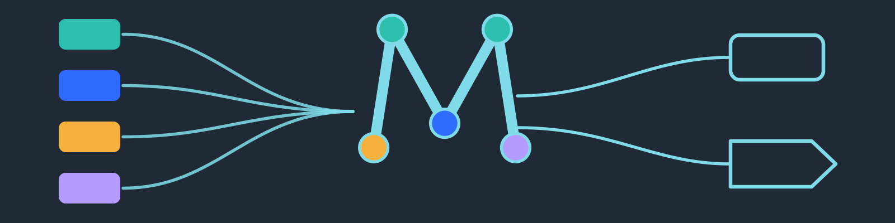

<p align="center">
  
</p>

# Building MaSyMoS 2.0

## Prerequisites

- JDK 25 on `PATH`, with `JAVA_HOME` pointing at it
- Maven 3.9.16 or newer
- Optional: Docker with Compose for the packaged service setup

The reactor is `modern/pom.xml` and targets `--release 25`. All modules share one version.

## Build and test

```powershell
cd modern
mvn -q verify
```

`verify` compiles every module and runs the unit tests. The fixture tests that read the workspace's
model corpus (SBML, CellML, SED-ML, OWL) report themselves as skipped here, each with its stated
reason. Test counts and current gate results are not repeated here, because a copy of a number
drifts.

Four gate classes read inputs the public tree does not carry, and this repository's verification
excludes them by name: `CitationAuditTest` and `DeferredFindingsGateTest` (they read the migration plans),
`PowerShellScriptAnalyzerTest` (it lints the workspace's `scripts/`) and `RepositoryEncodingTest` (it
walks the workspace's legacy `code/` tree as well). Everything else still runs: the formatting check,
the enforcer, compilation, the guarded integration tests and every module's unit tests. An excluded gate is
printed with its reason, so a verification run says what it did not check instead of leaving it implicit.

## Integration tests

Two opt-in lanes exist. Neither runs during the routine `verify`.

`testcontainers-it` starts its own Neo4j container, needs no external instance and no
credentials:

```powershell
cd modern
mvn -q -pl masymos-neo4j -Ptestcontainers-it verify
```

On a Docker 19.03 host every JVM container needs `--security-opt seccomp=unconfined`; the test
and `docker-compose.yaml` set it themselves.

`external-neo4j-it` runs against a Neo4j instance you declare disposable. It drops the MaSyMoS
full-text indexes and deletes all nodes in the declared database, so point it at a test database
only:

```powershell
cd modern
mvn -q -pl masymos-neo4j -Pexternal-neo4j-it verify `
  -Dmasymos.it.neo4j.uri=bolt://localhost:7687 `
  -Dmasymos.it.neo4j.username=<user> `
  -Dmasymos.it.neo4j.password=<password> `
  -Dmasymos.it.neo4j.database=<database>
```

## Docker

`modern/docker-compose.yaml` starts Neo4j 2026.05 plus the service built from
`modern/Dockerfile`. `mvn verify` must have produced the executable service jar first, because
the image copies it from `masymos-service/target/`.

```powershell
cd modern
'MASYMOS_NEO4J_PASSWORD=<password>' | Out-File -Encoding ascii .env
docker compose --env-file .env up -d --build
docker compose --env-file .env logs -f masymos-service
docker compose --env-file .env down
```

`MASYMOS_NEO4J_PASSWORD` is required and has no default.

## Service without Docker

```powershell
cd modern
mvn -q verify
java -jar masymos-service/target/masymos-service-2.0.0-SNAPSHOT.jar
```

Configuration is by environment variable; the Neo4j URI, user and password are the only
required settings, and the defaults point at `bolt://localhost:7687`.

## Command line interface

The CLI is service-backed and defaults to `http://localhost:8080`; `--api-url` overrides it.
`mvn verify` produces one self-contained jar - the shade step in `masymos-cli/pom.xml` merges the
module's dependencies, including `masymos-core`, JSBML and OWLAPI, into it:

```powershell
cd modern
mvn -q verify
java -jar masymos-cli/target/masymos-cli-2.0.0-SNAPSHOT.jar --help
```

No install step and no local Maven repository are needed to run it; a JDK is enough. The jar is
about 32 MB because it carries `masymos-core` with JSBML and OWLAPI inside. JSBML finds its
Level 3 package parsers through `META-INF/services`, so the shade step merges those service files
instead of keeping the first copy it meets: a plain merge would still start, and then fail to read
any document that uses a package such as FBC.

## Troubleshooting

- **Tests reported as skipped, e.g. "sample corpus not present"** - expected: the model fixtures
  stay in the MaSyMoS workspace and are not published, so those tests skip here by design.
- **`java.net.ConnectException` when running a CLI command** - no service is listening at
  `http://localhost:8080`. Start one (see above) or pass `--api-url` to a running instance.
- **The service starts but every query returns nothing** - the graph is empty until a document
  has been indexed. Index one with `POST /api/v1/index/models` or the CLI.
- **JVM containers exit with `pthread_create` EPERM** - a Docker 19.03 host. Add
  `--security-opt seccomp=unconfined`; the provided compose file and the container test already
  do.
- **Port 8080 or 7687 is taken** - stop the other instance or change the port in
  `docker-compose.yaml` and the service configuration.

## Documentation gates that run upstream only

The upstream workspace additionally checks its migration documents (a deferred-findings gate)
and lints its PowerShell scripts under `scripts/`. This repository publishes neither, so those
two tests skip here with a stated assumption. Everything that checks the code - compilation,
unit tests, the sample corpus, and the encoding rules of `.gitattributes` - runs here.
